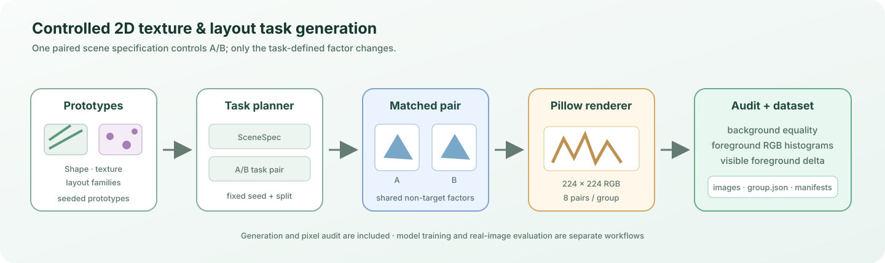
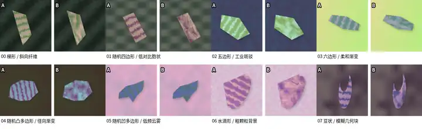
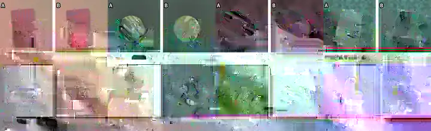

<div align="center">

# Industrial Image Synthesis

**A controlled 2D generator for matched industrial A/B tasks, texture-family variation, and spatial-layout relations.**

[](https://www.python.org/)
[](https://python-pillow.org/)
[](https://numpy.org/)
[](https://github.com/meamaturinlove221/industrial-image-synthesis/stargazers)

[Overview](#overview) · [A/B design](#matched-ab-design) · [Quick start](#quick-start) · [CLI](#command-line) · [Output](#dataset-output)



</div>

## Overview

Industrial Image Synthesis creates **matched A/B image groups** for controlled visual-relation experiments. Each task group defines one shared scene specification; A and B reuse the same shape, background, pose, position, scale, lighting, and shadow. Only the task-defined texture prototype or layout relation changes.

This public repository contains the **standalone 2D texture/layout task module** (module release 3.0.0). It uses Tkinter, Pillow, and NumPy, and does not require Blender.

The broader ManiTwin main workbench (2.1.2), Difficult simulation, Semantic Relation, and the optional Blender-based 3D relation-task extension are not included in this repository.

## A/B task examples

The images below are generated examples from the 2D task module. They show paired slots from the same task groups, not model predictions.

<p align="center">
  
</p>
<p align="center"><sub>Matched A/B slots: the task-defined texture or layout factor changes while the scene is shared.</sub></p>

<p align="center">
  
</p>
<p align="center"><sub>Validation examples include held-out texture families and shape families.</sub></p>

## What is generated

Each task group contains 8 matched A/B slots. Every slot contains one A image and one B image, so each group contains 16 RGB images.

| Setting | Default |
|---|---:|
| Recipe | `layout` |
| TRAIN groups | 3,200 |
| VAL groups | 640 |
| Matched A/B slots per group | 8 |
| Images per group | 16 |
| Image size | 224 × 224 |
| Random seed | 42 |
| Workers | 4 |
| Texture families | 20 train + 4 held out |
| Shape families | 16 train + 4 held out |

Default dataset size:

| Split | Groups | Images |
|---|---:|---:|
| TRAIN | 3,200 | 51,200 |
| VAL | 640 | 10,240 |
| **Total** | **3,840** | **61,440** |

All values are source defaults. Use the CLI or UI to change group counts, image size, seed, and worker count.

## Matched A/B design

The generator builds a `SceneSpec` for each paired slot. A and B share:

- Shape and background
- Base and accent colours
- Rotation, position, and scale
- Lighting and shadow
- Other scene-level parameters

The controlled difference depends on the recipe:

| Recipe | Task composition | Controlled difference |
|---|---|---|
| `texture` | 75% cross-family + 25% same-family hard pairs | Texture prototype |
| `layout` (default) | 25% cross-family + 25% same-family hard pairs + 50% region-layout pairs | Texture prototype or spatial-layout relation |

The layout task covers region position, arrangement, clustering versus dispersion, and connected versus separated regions.

### Pixel-level audit

The final RGB images are checked after rendering, not only at the abstract task-plan level. The audit verifies:

1. A/B background pixels are exactly equal.
2. Foreground R, G, and B channel histograms are exactly matched.
3. The foreground retains a visible pixel difference, measured by RGB MAE.
4. Task plans, generated files, group metadata, and split manifests agree.

This reduces the chance that a classifier can solve the task using only background changes or global foreground colour histograms.

## Quick start

### Requirements

- Windows, Linux, or macOS
- Python 3.10–3.13
- Tkinter for the desktop interface
- Pillow and NumPy

The 2D generator does not require Blender or an external image dataset.

### Install

```powershell
git clone https://github.com/meamaturinlove221/industrial-image-synthesis.git
cd industrial-image-synthesis

python -m venv .venv
.venv\Scripts\activate

python -m pip install -e .
```

On Linux or macOS, activate the environment with:

```bash
source .venv/bin/activate
python -m pip install -e .
```

### Launch the desktop app (Windows)

```powershell
.\启动纹理差异任务集.cmd
```

The interface lets you select the output directory, dataset name, recipe, split sizes, seed, and worker count. It supports preview, generation, audit, and resuming a compatible build.

## Command line

### 1. Preview a task group

```bash
python tools/texture_task_preview.py \
  --output-dir ./output/preview \
  --recipe layout \
  --seed 42
```

This writes paired A/B and cross-scene preview sheets.

### 2. Generate a small dataset

Start with a small run before generating the default dataset:

```bash
python tools/texture_task_generate.py \
  --output-root ./output \
  --dataset-name demo \
  --recipe layout \
  --train-groups 4 \
  --val-groups 4 \
  --workers 1
```

For the default 3,200/640 group dataset, omit the group-count options or set them explicitly.

### 3. Audit the generated dataset

```bash
python tools/texture_task_audit.py \
  --dataset-root ./output/demo
```

The default audit performs the deep image check. Use `--quick` only for a structural check; it is not a substitute for the full pixel audit.

## Dataset output

A generated dataset contains:

```text
demo/
├── train/
│   └── <group_id>/
│       ├── A/
│       ├── B/
│       └── group.json
├── val/
│   └── <group_id>/
│       ├── A/
│       ├── B/
│       └── group.json
├── train_plan.jsonl
├── val_plan.jsonl
├── train_groups.jsonl
├── val_groups.jsonl
├── dataset_summary.json
├── dataset_audit.json
├── sct_compatibility.json
└── build_state.json
```

| File | Purpose |
|---|---|
| `group.json` | A/B prototypes, shared scene, task type, and paired slots |
| `*_plan.jsonl` | Frozen generation plan for each split |
| `*_groups.jsonl` | Group-level manifest |
| `dataset_summary.json` | Dataset size and configuration |
| `dataset_audit.json` | Structural and pixel-level audit report |
| `sct_compatibility.json` | Data-interface description for the downstream classifier |
| `build_state.json` | Build progress and resume state |

The compatibility file describes the downstream data contract. It does not launch model training or perform inference.

## Tests

The repository includes tests for the 2D task planner, renderer, dataset contract, and UI interface contract.

```bash
python -m pip install pytest
python -m pytest -q tests/test_texture_tasks_3_0.py tests/test_texture_task_ui_contract_3_0.py
```

The two 2D task test modules passed **12 tests** in the current README revision check.

## Repository layout

```text
src/manitwin_image_platform/texture_tasks/
  dataset.py       Dataset options and build entry
  planner.py       Seeded A/B task-group planning
  scene.py         Shared scene specification
  prototype.py     Texture prototypes and family split
  shape_bank.py    Training and held-out shapes
  layout.py        Spatial-layout relations
  renderer.py      Pillow RGB rendering
  audit.py         Pair and pixel-level checks
  dataset_io.py    Dataset manifests and build state
ui/
  texture_task_app.py
  texture_task_jobs.py
  texture_task_layout.py
tools/
  texture_task_preview.py
  texture_task_generate.py
  texture_task_audit.py
tests/
  test_texture_tasks_3_0.py
  test_texture_task_ui_contract_3_0.py
```

## Downstream use

The generator exports image groups and manifests for downstream Support/Query sampling. The classifier is maintained separately in [Support-Conditioned Vision](https://github.com/meamaturinlove221/support-conditioned-vision).

The generated A/B groups are not automatically converted into a model-training schedule. A downstream experiment still needs to define the Support/Query sampling protocol, TRAIN/DEV split, labels, and training configuration.

## Release scope

- This repository contains the 2D texture/layout task generator only.
- The ManiTwin main workbench 2.1.2, Difficult simulation, Semantic Relation, and the Blender-based 3D relation-task extension are not included.
- The 2D generator uses procedural shapes, textures, and backgrounds; it does not require real industrial images or statistics derived from them.
- The broader project package metadata retains version 2.1.2; the standalone 2D task module is identified as 3.0.0.
- Full generated datasets, industrial images, external asset libraries, and runtime outputs are not included.

## License

This repository currently has no `LICENSE` file. Public visibility does not by itself grant permission to use, modify, or redistribute the code. Add a license only after confirming ownership and distribution terms.
