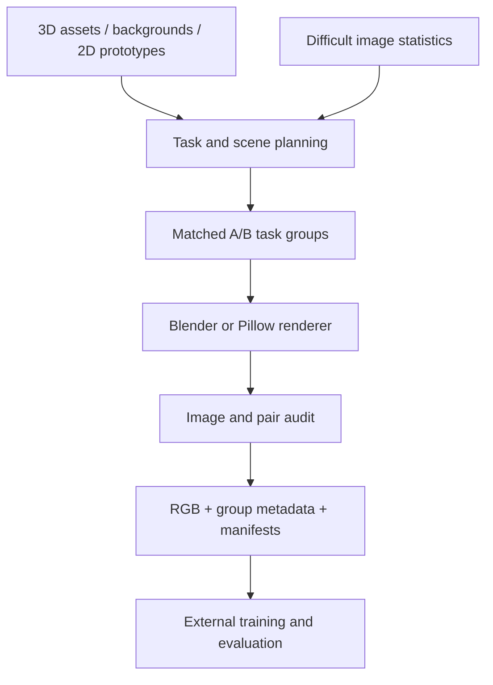

# Industrial Image Synthesis

> **Repository status:** this GitHub landing commit currently contains project documentation and publishing instructions. The complete source archive is prepared separately; run `publish.ps1` from the extracted archive to push the source tree to `main`.

A controlled industrial image-generation workbench for matched A/B tasks, Difficult-scene simulation, semantic relations, 2D texture/layout tasks, and an optional 3D relation-task extension.

> **Package versioning:** the main ManiTwin application remains **2.1.2**. The independent 2D texture/layout task module is **3.0.0**. The 3D relation-task extension is an additional research module, not the main application's version number.

## Modules

| Module | Implementation | Purpose |
|---|---|---|
| Main workbench | PySide6 + Blender | 3D asset and scene planning, batch rendering, Difficult simulation, Semantic Relation |
| Texture/layout tasks | Tkinter + Pillow + NumPy | 2D matched A/B tasks with texture-family and spatial-layout differences |
| 3D relation tasks | Tkinter + Blender 5.1 | Pose, texture, and surface-layout tasks; experiment orchestration uses a separate project |

## Generation flow



The generator creates images and records. It does not train DINOv2 or run SCT inference.

## 2D texture/layout defaults

| Setting | Default |
|---|---:|
| Recipe | `layout` |
| TRAIN groups | 3,200 |
| VAL groups | 640 |
| A/B slots per group | 8 |
| Images per group | 16 |
| Image size | 224 × 224 |
| Random seed | 42 |
| Texture families | 20 train + 4 held out |
| Shape families | 16 train + 4 held out |

Default output is 51,200 TRAIN images and 10,240 VAL images (61,440 total). The `layout` recipe allocates 25% cross-family texture pairs, 25% same-family hard texture pairs, and 50% region-layout pairs.

A/B share shape, background, base colours, pose, position, scale, light, and shadow. The task-specific texture prototype or layout relation is the controlled difference. The final audit checks exact background equality, foreground RGB histograms, and a visible foreground difference.

## 3D relation-task extension

The extension uses Blender 5.1, one representative GLB for each of 485 asset categories, and COCO backgrounds. Asset categories are split 388/97 for TRAIN/VAL; backgrounds use an 80/20 split. Each group contains eight A/B slots (16 RGB images) rendered at 512 × 512.

The full-stage budget is 19,340 unique groups (309,440 RGB images). This is a plan, not a claim that the full dataset has already been generated. The package includes a historical audit sample of 80 images: 38 of 40 pairs passed and 2 were rejected. This does not establish model training or real-image evaluation performance.

Support/Query sampling, training, and Difficult regression are managed by a separate experiment project, which is not included here. Configure it locally before using the 3D experiment controls.

## Difficult simulation

The main workbench summarizes real Difficult image distributions and plans new Blender scenes for nail plates, metal expansion screws, Tesla parts, and cylinder shafts. Real source images are not copied into generated datasets.

Cylinder semantic states include `single_complete`, `target_absent`, `multiple`, `partial`, and `wrong_component`. Only the first three map directly to counts 1, 0, and 2. The current `multiple` state means two pieces; it does not represent a separate 3+ class.

**Data-split caveat:** `DifficultDatasetProfiler` currently reads both `train` and `test` folders when calculating summary statistics. If the same test split must remain an untouched final holdout, do not use this merged profile to tune generation parameters and then describe that test split as fully independent.

## Installation (Windows)

Requirements: 64-bit Windows, Python 3.10–3.13, and Blender for 3D workflows. The 2D texture/layout task app uses Pillow and NumPy and does not require Blender.

```powershell
install.cmd
verify_runtime.cmd
start_platform.cmd
启动纹理差异任务集.cmd
启动三维关系任务集.cmd
```

The 3D relation-task UI requires local GLB assets, COCO backgrounds, Blender 5.1, and a configured external experiment project. Copy `configs/task3d.example.json` to `configs/task3d.local.json`, then set the local paths.

## Data and license

The repository does not include the full ManiTwin-100K asset library, COCO images, real industrial images, generated datasets, runtime logs, or local experiment outputs. Generate the approved background manifest from a local image folder with `python tools/build_background_manifest.py`.

The Support-conditioned classifier is maintained separately in [Support-Conditioned Vision](https://github.com/meamaturinlove221/support-conditioned-vision).

No license is included in this initial publication. Public visibility alone does not grant permission to reuse or redistribute the code or bundled project resources.
