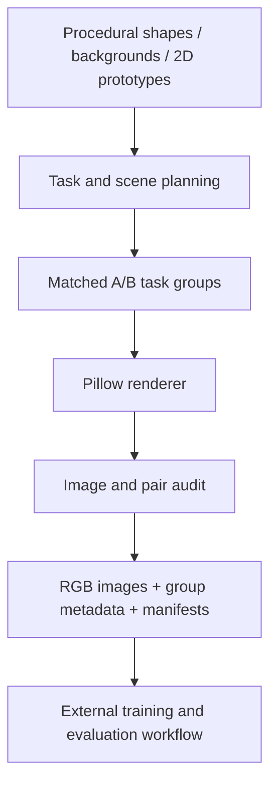

# Industrial Image Synthesis

A controlled industrial image-generation workbench for matched A/B tasks. This repository contains the standalone synthetic 2D texture/layout task module.

> **Package versioning:** the main ManiTwin application remains **2.1.2**. The independent 2D texture/layout task module is **3.0.0**. The main application and the optional 3D relation-task extension are not included in this source release.

## Capabilities

| Module | Implementation | Purpose |
|---|---|---|
| Texture/layout tasks | Tkinter + Pillow + NumPy | 2D matched A/B tasks with texture-family and spatial-layout differences |

## Generation flow



The generator creates images and records. It does not train DINOv2 or run SCT inference. Training and real industrial-image evaluation are separate stages.

## 2D texture/layout task defaults

The current source defaults are defined in `src/manitwin_image_platform/texture_tasks/dataset.py` and the task UI:

| Setting | Default |
|---|---:|
| Recipe | `layout` |
| TRAIN groups | 3,200 |
| VAL groups | 640 |
| Matched A/B slots per group | 8 |
| Images per group | 16 |
| Image size | 224 × 224 |
| Random seed | 42 |
| Texture families | 20 train + 4 held out |
| Shape families | 16 train + 4 held out |

That is 51,200 TRAIN images and 10,240 VAL images (61,440 total) when generated with the default settings. The `layout` recipe allocates 25% cross-family texture pairs, 25% same-family hard texture pairs, and 50% region-layout pairs. The `texture` recipe uses cross-family and same-family texture pairs.

Each pair shares its shape, background, base colours, pose, position, scale, light, and shadow. The task-specific texture prototype or layout relation is the controlled A/B difference. Final image auditing checks exact background equality, foreground RGB histograms, and a visible foreground difference.

## 3D relation-task extension

The optional Blender-based 3D relation-task extension is not included in this release.

## Difficult simulation

Difficult simulation is part of the main workbench and is not included in this release. The 2D module uses procedural shapes, textures, and backgrounds, not real industrial images or statistics derived from them.

## Installation (Windows)

Requirements: 64-bit Windows, Python 3.10–3.13, and Tkinter for the desktop app. The 2D texture/layout task app uses Pillow and NumPy and does not require Blender.

From the repository root, install the package in an activated virtual environment:

```powershell
python -m pip install .
```

Launch the independent task application:

```powershell
.\启动纹理差异任务集.cmd
```

You can also run the preview, generation, and audit commands directly:

```powershell
python tools/texture_task_preview.py --output-dir ./output/preview --recipe layout
python tools/texture_task_generate.py --output-root ./output --dataset-name demo --recipe layout --train-groups 4 --val-groups 4 --workers 1
python tools/texture_task_audit.py --dataset-root ./output/demo
```

## Output contracts

Outputs include RGB images, `group.json`, task plans, JSONL manifests, dataset summaries, audit reports, and resumable build state. The 2D task module also writes `sct_compatibility.json`; this describes the data interface and does not launch SCT training.

## Repository layout

```text
src/manitwin_image_platform/
  texture_tasks/   2D texture/layout generator
ui/                 Independent task interface
tools/              Generation, preview, and audit commands
tests/              Automated tests
```

## Data and privacy

The repository does not include the ManiTwin-100K asset library or index, COCO images, real industrial images or sample-derived configurations, generated datasets, runtime logs, or local experiment outputs. The included 2D module requires no external dataset.

## Related project

Support-Conditioned Vision is a separate classifier project. The generator exports task groups and manifests; model training and inference remain in the classifier/experiment workflow.

## License

No license is included in this initial publication. Public visibility alone does not grant permission to reuse, modify, or redistribute the code or bundled project resources. Add a license only after confirming ownership and distribution terms.
