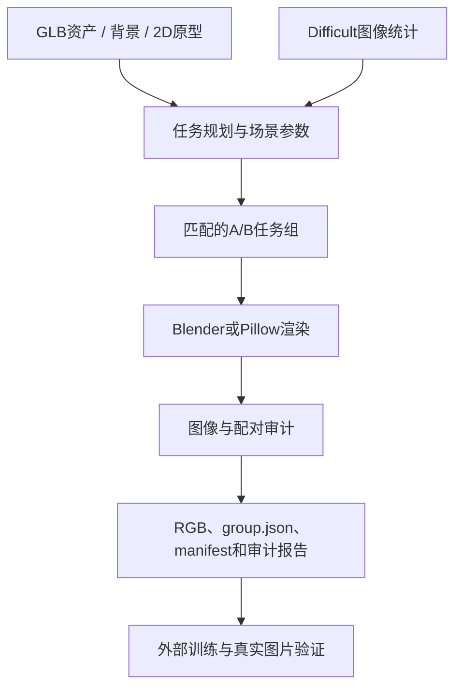

# Industrial Image Synthesis 技术说明

## 1. 项目定位与版本

本项目用于生成可控的工业合成图像和成对 A/B 任务数据。平台负责资源管理、任务规划、场景参数设置、渲染和结果审计；模型训练与真实工业图片验证由独立实验流程完成。

| 模块 | 版本 | 说明 |
|---|---|---|
| ManiTwin 主平台 | 2.1.2 | PySide6、Blender |
| 纹理/布局任务子平台 | 3.0.0 | Tkinter、Pillow、NumPy |
| 三维关系任务扩展 | regional-texture-multiview-v1 | 附加研究模块，不代表主程序版本 |

## 2. 总体流程

同一 Pair 中，除任务明确指定的判别因素外，形状、背景、构图、相机、光照和其他成像条件应保持一致。

## 3. 主平台 2.1.2

主程序使用 PySide6，包含通用图像生成、Difficult 场景拟合和 Semantic Relation。

Difficult 工作区针对甲片、金属膨胀螺丝、特斯拉零件和圆柱轴读取真实图像统计量，再生成新的 Blender 场景。真实原图不会复制到生成目录。

圆柱轴状态包括：`single_complete`（1件）、`target_absent`（0件）、`multiple`（2件）、`partial` 和 `wrong_component`。后两者不是纯数量标签；当前生成器中的 `multiple` 是两件，不包含 3+。

**数据划分限制：** `DifficultDatasetProfiler` 会同时遍历 `train` 和 `test` 并合并计算分布统计。如果 test 必须作为完全独立的最终留出集，就不能使用该合并统计调节生成参数后，再把同一 test 描述为完全独立验证集。

当前甲片表面拟合根据真实主体区域统计 6×12 粗粒度表面分布，按类别汇总中位模板，再用于圆润凸起主体的材质纹理。包内记录显示 Profiler 读取 504 张甲片图片，五类均生成 6×12 模板；10 张参数计划样本通过计划校验。这不代表已经完成 500 张新图的真实 Blender 像素验收。

## 4. 纹理/布局任务子平台 3.0.0

该子平台使用 Tkinter、Pillow 和 NumPy，不调用 Blender。

当前源码默认值：TRAIN 3,200 组、VAL 640 组；每组 8 个 A/B 配对槽位、16 张 224×224 图像；随机种子 42；训练/留出纹理族为 20/4，训练/留出形状为 16/4。默认规模为 TRAIN 51,200 张、VAL 10,240 张，合计 61,440 张。早期补丁文档和旧界面截图中的 6,250/625 组属于历史参数。

`texture` 配方包含 75% 跨纹理家族和 25% 同家族困难配对。`layout` 配方包含 25% 跨纹理家族、25% 同家族困难配对和 50% 区域布局配对。

同一 Pair 的 A/B 共用形状、背景、基础颜色、角度、位置、尺度、光照和阴影。最终图像审计检查背景像素完全相同、前景 RGB 直方图一致，并保留可见的前景差异。

输出包含任务计划、RGB 图像、每组 `group.json`、JSONL 清单、数据摘要、审计报告、`sct_compatibility.json` 和续跑状态。该兼容文件只定义数据接口，不会自动启动 SCT 训练。

## 5. 三维关系任务扩展

该模块使用 Blender 5.1、ManiTwin-100K GLB 和 COCO 背景。资产 485 类，按 388/97 划分 TRAIN/VAL；背景按 80/20 划分。每组 8 个 A/B 配对槽位，共 16 张 512×512 RGB。

full 阶段计划 19,340 个唯一任务组、309,440 张 RGB，这是阶段预算而非已完成生成量。包内历史小样为 5 组、80 张图，40 个配对槽位中 38 个通过、2 个拒绝。该样例不代表完整生成、训练或真实 Difficult 回归通过。

Support/Query 采样、训练和真实回归由外部实验工程管理；该工程不包含在本仓库中，需要通过 `configs/task3d.local.json` 配置。

## 6. 与 Support-Conditioned Vision 的关系

ManiTwin 负责生成图像、任务组和数据清单；Support-Conditioned Vision 负责 DINOv2 特征提取、Support 注册、QP 分类和产品任务路由。两者通过文件和清单衔接，不是同一进程中的直接调用关系。

当前 SCT 圆柱 LoRA 训练使用独立的 `cylinder_v4_p2a_20261026` 数据合同，不会自动读取本仓库的纹理/布局或三维关系任务输出。

## 7. 发布边界

- 主平台 2.1.2、2D 纹理/布局 3.0.0 和 3D 关系扩展分别说明，不混写版本。
- Difficult Profiler 合并读取 train/test；同一 test 不应再被称为完全独立留出集。
- `multiple` 当前对应两件，不包含 3+。
- 3D full 阶段仍为计划；80 张样例只证明小规模渲染和图像审计。
- 完整 GLB、COCO、真实工业图像、生成数据和外部实验工程不在仓库中。
- 未提供 LICENSE；公开仓库不自动授予代码和资源的再使用权。
